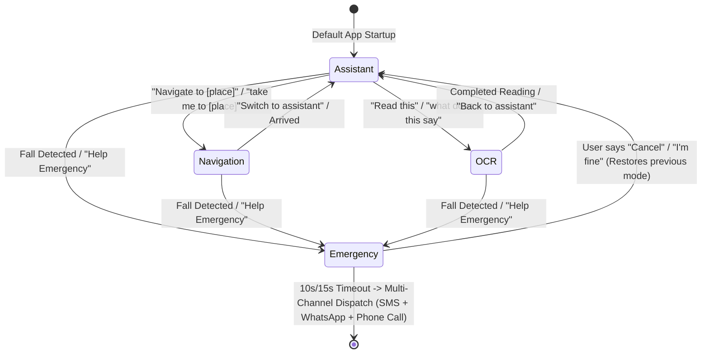

# Project Drishti: Complete Architectural Memory & Systematic Framework
> **Source Manuscript:** *Voice-First Multimodal Assistive Systems for Visually Impaired Mobility, Perception, and Safety: A Comprehensive Literature Review and Architectural Framework*  
> **Source Codebase:** [hackbios-neuraX](file:///E:/HAckbios-R&D/hackbios-neuraX) (`mksinha01/hackbios-neuraX`)  
> **Affiliation:** Project Drishti Research Group, Dept. of Computer Science and Engineering (`mksinha01/DRISHTI`), October 2026.  
> **Source Files:** [a (1).pdf](file:///E:/HAckbios-R&D/papers/a%20(1).pdf) | [hackbios-neuraX Repository](file:///E:/HAckbios-R&D/hackbios-neuraX)

---

## 1. Executive Summary & Clinical/Social Imperative
- **Demographics:** Over **2.2 billion** individuals globally suffer from vision impairment, with $\ge 1\text{ billion}$ experiencing preventable or unaddressed vision loss. $\approx 43\text{ million}$ people live with total blindness, and $295\text{ million}$ experience moderate-to-severe visual impairment (MSVI).
- **Physical Risks:** Visually impaired persons (VIPs) endure a **3-fold higher incidence of injurious falls** compared to age-matched sighted peers.
- **Infrastructure Gap:** In developing and emerging economies, municipal aids (tactile paving, acoustic pedestrian signals) are virtually absent, compounding hazards like open drainage ditches, broken sidewalks, scaffolding, low tree limbs, and chaotic traffic.

---

## 2. Four Perceptual Blind Spots of the Hoover Long Cane
Although Richard Hoover's post-WWII white cane remains the gold standard for detecting ground-level changes (curbs, steps, drops within $\approx 1\text{ meter}$), it fails critically in four areas:
1. **Head- and Chest-Level Blindness:** Ground sweep leaves an elevated cone completely unprotected (open truck tailgates, scaffolding, tree limbs, construction awnings).
2. **Zero Remote Horizon:** Cane reach is $\approx 1.0 - 1.4\text{ m}$. At standard walking pace ($1.2\text{ m/s}$), the user has less than **1.0 second** to detect and decelerate.
3. **Dynamic Trajectory Blindness:** The cane cannot assess closing velocity or heading vectors of moving entities (bicycles, approaching pedestrians, animals).
4. **Semantic Invisibility:** Provides tactile presence without identification (cannot differentiate a soft cardboard box from a hot engine exhaust or aggressive dog).

---

## 3. Four Generations of Assistive Technology

| Gen | Technology Class | Key Examples | Mechanism | Key Bottlenecks |
|---|---|---|---|---|
| **1** | Mechanical Aids | Hoover Long Cane, Braille slates, Guide Dogs | Ground contact, mechanical echo | Elevated blindness, zero semantics, short reach |
| **2** | Acoustic/Ultrasonic ETAs | Sonicguide, UltraCane | 40 kHz ultrasound / IR time-of-flight to pitch/buzz | Narrow cone, specular reflection failure, false echoes |
| **3** | CV Wearables | OrCam MyEye 2, Envision Glasses, Seeing AI | Classical CV / early CNN classification | High cost ($2,500–$4,500), manual aiming, rigid menus |
| **4** | **Conversational Multimodal AI (Drishti)** | **Project Drishti** | **Dual-Tier: Edge YOLOv8n INT8 + Cloud LiveKit WebRTC MLLMs (GPT-4o/Gemini 2.0)** | **Decouples sub-400ms reflex from conversational intelligence** |

---

## 4. Theoretical Foundations & Mathematical Formulations

### 4.1 Auditory Cognitive Overload & Sensory Substitution
Sensory Substitution Devices (SSDs) leverage occipital neuroplasticity. However, continuous auditory frequency soundscapes (e.g. *The vOICe*, *EyeMusic*) cause severe mental exhaustion and **auditory masking** of natural ambient echolocation cues:
$$C_{\text{load}} \propto \int_{0}^{T} \left( \sum_{i=1}^{N_f} H(\text{freq}_i, \text{amp}_i) \right) dt \quad \text{(Eq. 1)}$$

Drishti replaces continuous soundscapes with discrete, prioritized **earcons** and **alert hysteresis** ($\Delta t \ge 5\text{ s}$ cooldown):
$$\Phi_{\text{fatigue}} = \int_{0}^{T} \sum_{k=1}^{M} w_k \cdot \delta(t - t_k) dt \quad \text{(Eq. 9)}$$

### 4.2 Edge Model Quantization (PTQ & QAT)
Affine mapping of continuous FP32 tensors to uniform 8-bit integers (INT8):
$$q = \text{round}\left( \frac{r}{S} \right) + Z \quad \text{(Eq. 2)}$$
Executed via TFLite using **NNAPI** (Qualcomm Hexagon, MediaTek APU) or **GPU Delegates** (Vulkan/OpenGL ES), achieving **26.4 ms** inference latency.

### 4.3 Monocular Depth & Proximity Geometry
Given a calibrated chest camera at elevation $H_{\text{cam}}$ and focal length $f_y$, physical distance $d$ to an object of real height $H_{\text{obj}}$ is:
$$d \approx \frac{f_y \cdot H_{\text{obj}}}{h_{\text{bbox}} \cdot I_{\text{height}}} \quad \text{(Eq. 3)}$$
Horizontal azimuth is partitioned into three discrete cones:
$$\text{Azimuth} = \begin{cases} \text{Left}, & x_c < 0.35 \\ \text{Center}, & 0.35 \le x_c \le 0.65 \\ \text{Right}, & x_c > 0.65 \end{cases} \quad \text{(Eq. 4)}$$
Bounding box expansion rate $\frac{\partial(w \cdot h)}{\partial t}$ functions as an optical flow proxy for Time-to-Collision (TTC).

### 4.4 Pedestrian Dead Reckoning (PDR)
Compensates for 10–20 meter urban canyon GPS multipath drift:
$$a_{\text{vert}}(t) = \mathbf{a}(t) \cdot \hat{\mathbf{g}} - g \quad \text{(Eq. 6)}$$
Weinberg stride length formula:
$$L_{\text{stride}} = K \cdot \sqrt[4]{a_{\text{max}} - a_{\text{min}}} \quad \text{(Eq. 7)}$$

### 4.5 Fall Biomechanics & Fail-Safe Verification
Continuous tri-axial acceleration $\mathbf{a}(t) = [a_x, a_y, a_z]^T$:
$$\text{SVM}(t) = \sqrt{a_x^2(t) + a_y^2(t) + a_z^2(t)} \quad \text{(Eq. 8)}$$
Four sequential phases:
1. **Free Fall / Descent:** $\text{SVM}(t) < 0.5g$ for $\Delta t \approx 100 - 200\text{ ms}$.
2. **Ground Impact:** $\text{SVM}(t) > 2.5g\text{ to }4.0g$.
3. **Rebound / Settle:** Rapid oscillatory damping.
4. **Post-Fall Immobility:** $\sigma^2(\text{SVM}) < 0.05g^2$ over $\Delta t \ge 3.0\text{ s}$.

---

## 5. System Architecture: Three Functional Tiers

### Tier 0: Hardware & Sensors (Sub-10 ms)
- **Primary Visual Node:** Chest-mounted ESP32-CAM (Xtensa dual-core LX6 @ 240 MHz, 520 KB SRAM, 4 MB PSRAM, OV2640 2MP sensor). Emits VGA (640x480) HTTP MJPEG over Wi-Fi SoftAP @ 10–15 FPS.
- **Secondary Visual Node:** Android Smartphone camera via native CameraX (zero-downtime hot failover if external socket drops or latency exceeds 500 ms).
- **Audio & Haptic:** In-ear/bone-conduction headset microphone and speaker.
- **Inertial Sensing:** 3-axis IMU accelerometer for step counting and fall detection.

### Tier 1: Android Native Edge Core (Sub-400 ms Reflex — 100% Offline)
- **Camera Manager:** Frame multiplexer with zero-downtime failover and background auto-reconnect polling.
- **TFLite Detector:** Quantized YOLOv8n INT8 model (3.2M params, 8.7 GFLOPs, 52.1 mAP50, 26.4 ms latency) running on NNAPI/GPU delegates.
- **Proximity Heuristic Engine:** Calculates physical distance (Eq. 3), azimuth (Eq. 4), and TTC expansion.
- **LocalTTS Reflex Engine:** Preemptively ducks cloud WebRTC audio track by 80% (or pauses) to speak urgent obstacle warnings (*"Stop, vehicle approaching right"*).
- **Mode Manager:** State machine managing Navigation, OCR, Obstacle, and Fall safety states.

### Tier 2: Cloud Conversational Intelligence (1.0 – 2.0 s)
- **FastAPI Token Server:** Authenticates client and issues JWT session tokens.
- **LiveKit WebRTC Platform:** Low-latency bidirectional multi-track audio streaming over UDP (SRTP), with adaptive jitter buffering, acoustic echo cancellation (AEC), and noise suppression.
- **WebRTC DataChannels:** Transmits video frames (JPEG) and telemetry (GPS, detected bounding box rosters) synchronously with audio.
- **Streaming STT:** Streaming Conformer architectures (Sarvam Saaras v3, Google Speech Streaming) transcribing phonemes in $< 250\text{ ms}$.
- **Multimodal LLM Worker:** GPT-4o / Gemini 2.0 Flash for open-ended scene reasoning, spatial corridor description, facial expression analysis, and document Q&A.
- **Streaming TTS:** Sarvam Bulbul / Silero TTS for natural conversational cadence ($< 1.5\text{ s}$ round-trip).
- **Voice Turn-Taking:** Silero VAD for instant user barge-in (instantly flushes playback buffers and truncates agent speech).

---

## 6. End-to-End Latency Budgets (Table 3)

```
Tier 1: Local Obstacle Reflex (Edge Only - 100% Offline)
-----------------------------------------------------------------------------
Frame Capture (ESP32 OV2640 / CameraX):            40 - 80 ms
MJPEG Parsing (Coroutines Bitmap):                  15 - 30 ms
Neural Inference (YOLOv8n INT8 via NNAPI/GPU):     25 - 45 ms
Proximity Heuristic (BBox Geometric Parser):       < 2 ms
Local Speech Alert (Android Native TTS):           80 - 150 ms
-----------------------------------------------------------------------------
TOTAL TIER 1 HAZARD DETECTION TO EARPHONE:         ~160 - 305 ms (Target: <400 ms)

Tier 2: Conversational Scene Q&A (Cloud MLLM)
-----------------------------------------------------------------------------
Audio Capture (Earphone Mic + Opus Encoder):       20 - 40 ms
WebRTC Uplink (LiveKit Edge Server UDP):           30 - 70 ms
Streaming STT (Sarvam Saaras v3 / Whisper):        200 - 350 ms
Frame Upload (WebRTC DataChannel JPEG):            80 - 160 ms
MLLM TTFT (GPT-4o / Gemini 2.0 Flash):            600 - 1200 ms
Streaming TTS (Sarvam Bulbul / Silero):            150 - 300 ms
WebRTC Downlink (Earphone Audio Playback Buffer):  30 - 60 ms
-----------------------------------------------------------------------------
TOTAL TIER 2 SPOKEN QUERY TO SPOKEN ANSWER:        ~1.1 - 2.2 s
```

---

## 7. Algorithm 1: Fail-Safe Fall Detection & Multi-Channel Dispatch

```
Continuous IMU a(t) ---> Compute SVM(t)
                              |
               SVM(t) > 2.5g (Ground Impact)?
                              | Yes
                   Wait t_settle = 2.0 s
                              |
       Stillness Check: Var(SVM) < 0.2g for 3.0 s?
                              | Yes
             Trigger 15s Emergency Voice Window
         "Fall detected. Are you okay? Say cancel to abort."
                              |
         +--------------------+--------------------+
         | User says "cancel", "stop", "I'm fine"  | No voice response (15s expired)
         v                                         v
   Abort Alert; Return to Normal          MULTI-CHANNEL EMERGENCY DISPATCH:
                                          1. Direct SMS with GPS + Google Maps link
                                          2. WhatsApp Automated Intent to Caregiver
                                          3. Automated Phone Call (ACTION_CALL) on speaker
                                          4. Continuous High-Decibel Siren (if offline)
```

---

## 8. Comparative State-of-the-Art Analysis (Table 4)

| Feature | OrCam MyEye 2 | Envision Glasses | Microsoft Seeing AI | Be My AI | Project Drishti |
|---|---|---|---|---|---|
| **Cost** | $\approx \$4,000$ | $\approx \$2,500$ | Free App | Free App | **$<\$60$ Hardware** |
| **Form Factor** | Eyeglass clip (22g) | Google Glass EE2 | Phone (handheld) | Phone (handheld) | **Chest mount / Phone** |
| **Operation** | Touch-bar tap | Touchpad / voice | Touchscreen swipes | Touchscreen tap | **Hands-free Voice-First** |
| **Offline Mode** | 100% Offline | Hybrid (fails without net) | Local scene, no reflex | Fails 100% offline | **Sub-400ms Local Reflex** |
| **Cloud Intelligence**| None | Cloud OCR / GPT-4 | Azure Vision | GPT-4o Vision | **WebRTC LiveKit + MLLM** |
| **Audio Prioritization**| None | None | None | None | **Priority Audio Ducking (80%)** |
| **Fall Safety** | None | None | None | None | **Autonomous 4-Channel Dispatch** |

---

## 9. Bystander Privacy & Ethical Safeguards
1. **Zero Cloud Video Retention:** Video frames streamed to cloud agents are processed strictly in volatile RAM buffers for real-time inference and immediately discarded. No video frames are logged to persistent cloud storage.
2. **Local On-Device Face Embeddings & Detection:** Face detection (Google ML Kit `PERFORMANCE_MODE_FAST`) runs entirely on-device with tracking enabled. No raw face crops or persistent biometric embeddings are retained without explicit user consent.

---

## 10. Production Implementation Realities (from `hackbios-neuraX` Codebase)

> **Repository Reference:** [hackbios-neuraX](file:///E:/HAckbios-R&D/hackbios-neuraX)  
> **Concrete Topology:** `android/` (Kotlin 24/7 foreground core) + `agent/` (LiveKit Python worker) + `token-server/` (FastAPI JWT & auto-dispatch) + `esp32-firmware/` (ESP32-CAM MJPEG streamer).

### 10.1 Key Engineering Differentiators: Theoretical Paper Blueprint vs. Production Codebase

| Feature / Dimension | Theoretical Paper Blueprint (`a (1).pdf`) | Production Codebase (`hackbios-neuraX`) | Technical Rationale & Impact |
|---|---|---|---|
| **YOLOv8n Quantization & Input** | YOLOv8n INT8 @ $640 \times 640$ (26.4 ms latency) | **`yolov8n_float16.tflite` (Float16) @ $320 \times 320$** | $320 \times 320$ reduces MAC operations by 4x, preventing thermal throttling on mid-range Android chipsets while preserving COCO mAP on near-field obstacles. |
| **TFLite Execution Engine** | Generic NNAPI / GPU delegates | **4 CPU threads + `setUseNNAPI(true)`** | Evaluates output tensor `[1, 84, 2100]` with fallback to CPU threads if vendor NNAPI HAL fails. |
| **Distance Estimation Heuristic** | Pinhole optical formula: $d \approx (f_y \cdot H_{\text{obj}}) / (h_{\text{bbox}} \cdot I_{\text{height}})$ | **Empirical inverse height:** $d = 0.8 / \text{safeHeight}$ (where $\text{safeHeight} \in [0.05, 1.0]$) | Eliminates calibration dependency and camera tilt error; directly maps bounding box frame occupancy to distance (rounded to 0.1m, capped at 4.0m). |
| **Hazard Priority Thresholds** | Abstract distance thresholding | **14 hazard classes**, with **`car, bus, truck, motorcycle, person` prioritized at $d < 2.5\text{ m}$** | High-priority hazards trigger immediate interrupted speech alerts (`flush = true`), while minor obstacles follow mode intervals. |
| **Azimuth & Spatial Mapping** | Continuous azimuth cones ($x_c < 0.35, 0.35 \le x_c \le 0.65, x_c > 0.65$) | **Clock-face directions:** Left ("10 o'clock"), Center ("12 o'clock"), Right ("2 o'clock") | Intuitive cognitive mental model for VIPs; immediately translates to walking orientation. |
| **Fall Biomechanics** | Descent ($<0.5g$), Impact ($>2.5g$), Settle ($2.0\text{ s}$), Immobility variance ($\sigma^2 < 0.05g^2$ over $3\text{ s}$) | **Impact magnitude $> 25.0\text{ m/s}^2$ ($\approx 2.55g$), followed by stillness magnitude $< 11.5\text{ m/s}^2$ within $2000\text{ ms}$** | Replaces statistical variance calculations with low-overhead instant threshold windowing, reducing CPU cycles on the sensor thread. |
| **Emergency Countdown** | Static 15s window | **15s for sensor fall, 10s for voice trigger** (`"help emergency"`) | Voice-initiated emergencies presume user consciousness and require faster dispatch (10s), whereas falls allow 15s for disorientation recovery. |
| **Audio Priority & Ducking** | 80% volume ducking calculation | **Strict collision prevention:** Local TTS suppresses routine mode change speech if LiveKit voice is connected | Eliminates audio collision between cloud agent and local TTS; reserves local TTS strictly for edge safety reflexes and countdown ticks. |
| **Camera Frame Uplink** | Abstract WebRTC video tracks | **Downscaled $320 \times 240$ JPEG (40% quality, $<15\text{ KB}$ Base64) every 2.0 seconds over DataChannel** | Avoids WebRTC video encoder CPU overhead on Android; fits comfortably within DataChannel buffer limits without frame dropping. |
| **Cloud LLM Prioritization** | GPT-4o / Gemini 2.0 Flash | **Groq LPU (`openai/gpt-oss-120b`) $\to$ OpenAI `gpt-4o` $\to$ Google `gemini-2.0-flash`** | Groq LPU achieves ultra-fast TTFT (<300 ms), critical for conversational voice latency. |
| **Agent Prompt Brevity Rule** | Natural conversational assistance | **Strict Brevity Mandate:** *"CRITICAL RULE: Always give answers in short! Keep every response strictly to 1 to 2 short sentences."* | Enforces concise, rapid audio delivery so VIPs can maintain situational awareness of street sounds. |
| **Face Recognition vs Privacy** | MobileFaceNet 128-d local embeddings | **ML Kit Face Detection (`PERFORMANCE_MODE_FAST`) with tracking only** | Fully zero-storage privacy compliance; detects presence/bounding boxes without saving face crops or identity embeddings. |

---

### 10.2 Production State Machine: Dynamic Operational Modes (`ModeConfig`)

The Android native core uses Kotlin sealed classes (`DrishtiMode`) paired with dynamic `ModeConfig` throttling:



#### Mode Dynamic Throttling Parameters:
- **Assistant Mode (Default):**
  - Obstacle inference interval: **300 ms** (~3.3 FPS)
  - Max proximity alert distance: **3.0 meters**
  - Local TTS speech rate: **1.0x**
- **Navigation Mode:**
  - Obstacle inference interval: **200 ms** (~5 FPS) for heightened mobility awareness
  - Max proximity alert distance: **4.0 meters**
  - Local TTS speech rate: **1.05x** (slightly snappier)
  - Waypoint tracking: Approaching announcement at $\le 15\text{ m}$; progress alerts every $50\text{ m}$.
- **OCR / Reading Mode:**
  - Obstacle inference interval throttled to: **600 ms** (conserves CPU/battery while user holds document)
  - Local TTS speech rate: **0.95x** (slower cadence for clear text comprehension)
  - Auto-capture delay: **1000 ms**
- **Emergency Mode:**
  - Countdown duration: **10 seconds** (voice) / **15 seconds** (sensor fall)
  - Local TTS speech rate: **1.1x** (urgent cadence)
  - Spoken countdown tick every second with cancel phrase monitoring.

---

### 10.3 Bi-Directional WebRTC DataChannel Protocol Schema

LiveKit WebRTC DataChannels handle JSON telemetry and synchronization between the Android client and the Python Agent worker:

#### 1. Android Phone $\to$ Cloud Agent:
```json
// Camera Frame Streaming (Dispatched every 2.0s or on request)
{ "type": "CAMERA_FRAME", "image_base64": "<base64_jpeg_320x240>", "timestamp": 1728461234567 }

// Edge Obstacle Hazard Notification
{ "type": "OBSTACLE_WARNING", "obstacle": "car", "position": "on your right", "distance": 1.8 }

// Edge OCR Extraction Result
{ "type": "OCR_RESULT", "text": "Crocin 500mg Paracetamol Tablets IP", "subAction": "read" }

// Local Mode Change Notification
{ "type": "MODE_CHANGE", "mode": "navigation" }
```

#### 2. Cloud Agent $\to$ Android Phone:
```json
// Request Fresh Frame for Scene Q&A
{ "type": "REQUEST_FRAME" }

// Request Local ML Kit Text Scan
{ "type": "REQUEST_OCR" }

// Trigger Turn-by-Turn Route Execution
{ "type": "REQUEST_NAVIGATION", "destination": "Metro Station" }

// Command Mode Switch
{ "type": "SWITCH_MODE", "target": "assistant" }
```

---

### 10.4 LiveKit Agent Multi-Provider Stack (`drishti_agent.py`)

- **Speech-to-Text (STT):** `sarvam.STT(language="en-IN", model="saaras:v4", mode="transcribe", flush_signal=True)`. Explicit language specification bypasses heavy Language Identification (LID) latency.
- **Voice Activity Detection (VAD):** `silero.VAD.load(min_silence_duration=0.28, activation_threshold=0.5, prefix_padding_duration=0.2)`. Ultra-tight 280 ms silence window ensures rapid turn handover.
- **Large Language Model (LLM):** Multi-provider fallback cascade:
  1. **Groq LPU (`openai/gpt-oss-120b`):** Sub-300 ms TTFT for real-time voice cadence.
  2. **OpenAI (`gpt-4o`):** High-precision conversational reasoning and vision parsing.
  3. **Google Gemini (`gemini-2.0-flash`):** Multimodal context and scene description.
- **Text-to-Speech (TTS):** `sarvam.TTS(target_language_code="hi-IN", model="bulbul:v3", speaker="kabir", pace=1.05, enable_preprocessing=False)`.
- **Function Tools Available to Agent:**
  - `describe_scene()`: Fetches cached or fresh frame, calls Vision LLM (`max_tokens=80`), describes path in 1-2 sentences.
  - `switch_mode(target_mode)`: Switches agent system prompt smoothly and broadcasts `SWITCH_MODE` to phone.
  - `start_navigation(destination)`: Verifies mode is `navigation`, dispatches `REQUEST_NAVIGATION` to Android app.
  - `read_text_in_view()`: Calls Vision LLM (`max_tokens=120`) to transcribe labels/signs and highlights product/medicine details.

---

### 10.5 Token Server & Auto-Dispatch Architecture (`main.py`)

- **FastAPI Endpoint:** `GET /token?room={room}&user={user}`.
- **Permissions:** Issues `AccessToken` with `VideoGrants(room_join=True, can_publish=True, can_subscribe=True, can_publish_data=True)`.
- **Automatic Agent Dispatch:** Uses `LiveKitAPI.agent_dispatch.list_dispatch()` / `CreateAgentDispatchRequest()` so an idle agent worker is instantly spun up and assigned to the room the moment the Android phone requests connection credentials.
- **Multi-Candidate Failover Chain:**
  1. Configured Primary Token URL (`preferenceManager.tokenServerUrl`)
  2. ADB USB Reverse Port Forwarding (`http://127.0.0.1:8000`)
  3. Local Wi-Fi Host IP (`http://10.113.162.33:8000`)
  4. Android Emulator Loopback (`http://10.0.2.2:8000`)

